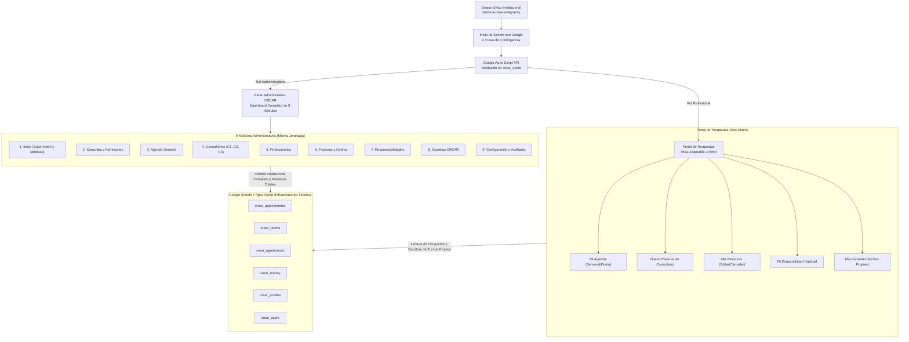
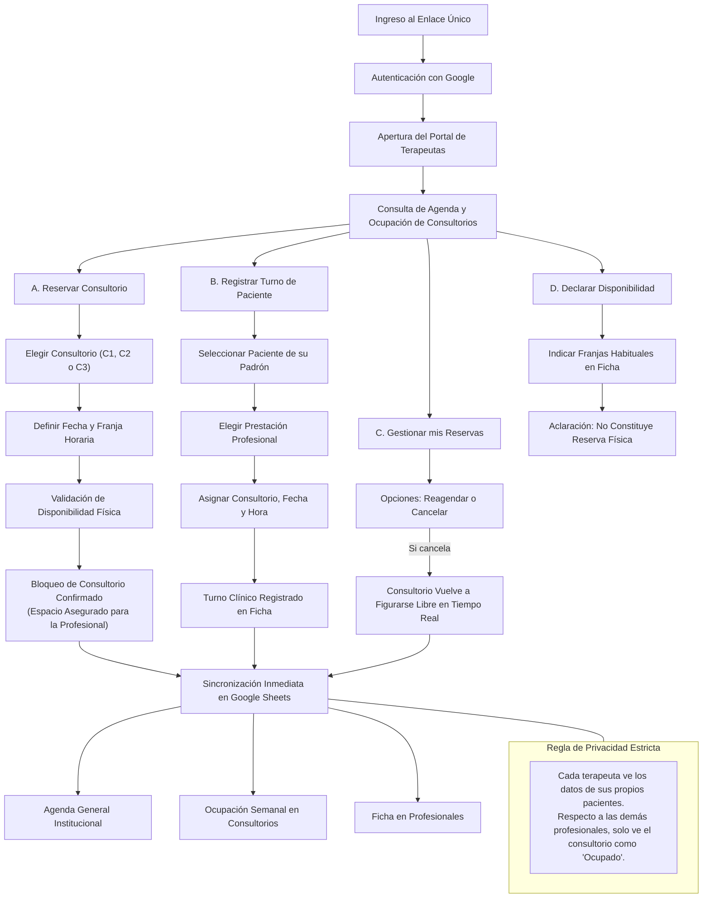
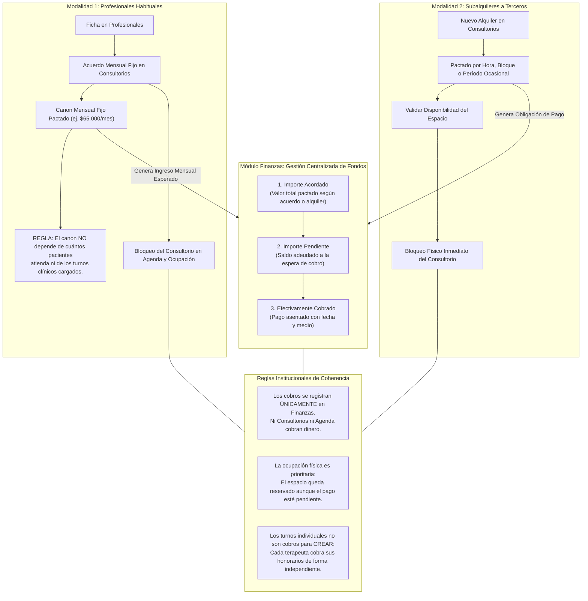

```mermaid
flowchart TD
    ADMIN_LOGIN["Ingreso Responsable (Rol Admin)"] --> DASH["Dashboard Original CREAR"]
    
    subgraph NUEVE_MODULOS ["Nueve Módulos de Igual Jerarquía"]
        M_HOME["Inicio"]
        M_ADM["Consultas y Admisiones"]
        M_AGENDA["Agenda General"]
        M_ROOMS["Consultorios"]
        M_PROFS["Profesionales"]
        M_FIN["Finanzas"]
        M_RESP["Responsabilidades"]
        M_COV["Guardias CREAR"]
        M_SET["Configuración"]
    end
    DASH --> NUEVE_MODULOS

    %% CIRCUITO 1: CONSULTA Y ADMISIÓN
    subgraph C1 ["Circuito 1: Consulta y Admisión de Familias"]
        M_ADM -->|Recepción de Familia| ADM_REG["Registro de Derivación"]
        ADM_REG --> ADM_ENT["Coordinación de Entrevista Inicial"]
        ADM_ENT -->|Si es presencial| M_AGENDA
        ADM_ENT -->|Asignación Clínica| M_PROFS
    end

    %% CIRCUITO 2: ALTA DE PROFESIONAL
    subgraph C2 ["Circuito 2: Alta y Configuración de Profesional"]
        M_PROFS -->|Alta de Ficha| PRO_DATOS["Datos, Matrícula y Prestaciones"]
        PRO_DATOS --> PRO_USER["Habilitación de Acceso al Portal"]
        PRO_USER -->|Acuerdo Mensual de Uso| M_ROOMS
        M_ROOMS -->|Bloques Habilitados| M_AGENDA
    end

    %% CIRCUITO 3: TAREAS INTERNAS
    subgraph C3 ["Circuito 3: Organización Interna de Socias"]
        M_RESP --> RESP_TASK["Asignación y Seguimiento de Tareas"]
        RESP_TASK --> RESP_NOTE["Proceso 100% Autónomo (Sin consultorios)"]
    end

    %% CIRCUITO 4: GUARDIAS
    subgraph C4 ["Circuito 4: Guardias Institucionales"]
        M_COV --> COV_PLAN["Cronograma Semanal de Coberturas"]
        COV_PLAN -.->|Solo si requiere sala presencial| M_AGENDA
    end

    %% SUPERVISION EN INICIO
    M_ROOMS -.->|Ocupación física| M_HOME
    M_FIN -.->|Vencimientos y cobros| M_HOME
    M_ADM -.->|Admisiones pendientes| M_HOME
    M_COV -.->|Guardias del día| M_HOME
```

# CREAR — Manual de Flujogramas y Arquitectura Funcional

**Institución:** CREAR — Espacio Terapéutico Interdisciplinario  
**Versión:** 2.0 (Arquitectura Funcional y Operativa Descentralizada)  
**Fecha:** Octubre 2026  

---

## 1. Principio Rector de Arquitectura

> [!IMPORTANT]
> **AGENDA NO ES EL CENTRO DE LA ADMINISTRACIÓN DE CREAR.**
> Los nueve módulos administrativos tienen responsabilidades propias e igual jerarquía funcional. El módulo **Inicio** actúa como monitor ejecutivo y tablero de supervisión, pero no reemplaza ni gobierna los procesos de las demás áreas. La infraestructura compartida de almacenamiento y validación de permisos es **Google Sheets + Apps Script**.

```
NIVEL 1: Acceso institucional único y derivación automática de perfil
NIVEL 2: 9 Módulos administrativos de igual jerarquía + Portal de terapeutas
NIVEL 3: Infraestructura técnica compartida (Google Sheets + Apps Script)
```

---

## 2. Flujograma 1: CREAR — Organización general del sistema

### Diagrama Mermaid (Editable)



---

## 3. Flujograma 2: CREAR — Cómo registrar y gestionar turnos

### Diagrama Mermaid (Editable)



---

## 4. Flujograma 3: CREAR — Gestión administrativa institucional

### Diagrama Mermaid (Editable)



---

## 5. Flujograma 4: CREAR — Gestión de espacios y economía

### Diagrama Mermaid (Editable)



---

## 6. Archivos Generados en el Proyecto

Los flujogramas se encuentran listos para visualizar e imprimir en la carpeta `docs/flujogramas/`:

1. [flujograma_1_organizacion_general.html](file:///c:/Users/usuario/Desktop/Autosol%20Jujuy/Nelson/CREAR%20-%20Antigravity/docs/flujogramas/flujograma_1_organizacion_general.html) / [PDF individual](file:///c:/Users/usuario/Desktop/Autosol%20Jujuy/Nelson/CREAR%20-%20Antigravity/docs/flujogramas/flujograma_1_organizacion_general.pdf)
2. [flujograma_2_circuito_terapeutas.html](file:///c:/Users/usuario/Desktop/Autosol%20Jujuy/Nelson/CREAR%20-%20Antigravity/docs/flujogramas/flujograma_2_circuito_terapeutas.html) / [PDF individual](file:///c:/Users/usuario/Desktop/Autosol%20Jujuy/Nelson/CREAR%20-%20Antigravity/docs/flujogramas/flujograma_2_circuito_terapeutas.pdf)
3. [flujograma_3_circuito_administrativo.html](file:///c:/Users/usuario/Desktop/Autosol%20Jujuy/Nelson/CREAR%20-%20Antigravity/docs/flujogramas/flujograma_3_circuito_administrativo.html) / [PDF individual](file:///c:/Users/usuario/Desktop/Autosol%20Jujuy/Nelson/CREAR%20-%20Antigravity/docs/flujogramas/flujograma_3_circuito_administrativo.pdf)
4. [flujograma_4_espacios_y_finanzas.html](file:///c:/Users/usuario/Desktop/Autosol%20Jujuy/Nelson/CREAR%20-%20Antigravity/docs/flujogramas/flujograma_4_espacios_y_finanzas.html) / [PDF individual](file:///c:/Users/usuario/Desktop/Autosol%20Jujuy/Nelson/CREAR%20-%20Antigravity/docs/flujogramas/flujograma_4_espacios_y_finanzas.pdf)
5. **Documento Maestro Completo (4 diagramas reunidos):**  
   - [flujogramas_crear_completo.html](file:///c:/Users/usuario/Desktop/Autosol%20Jujuy/Nelson/CREAR%20-%20Antigravity/docs/flujogramas/flujogramas_crear_completo.html)  
   - [CREAR_Flujogramas_Arquitectura_Funcional.pdf](file:///c:/Users/usuario/Desktop/Autosol%20Jujuy/Nelson/CREAR%20-%20Antigravity/docs/flujogramas/CREAR_Flujogramas_Arquitectura_Funcional.pdf)

